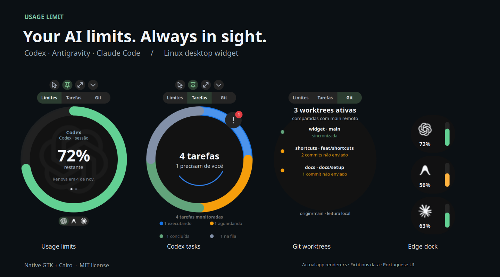

# Usage Limit

**Keep AI usage limits, Codex tasks, and Git worktrees in view while you code.**

A floating Linux desktop widget for **Codex, Antigravity, and Claude Code**, built with Python, GTK 3, and Cairo.

[](https://github.com/mehiel-victor/usage-limit/actions/workflows/checks.yml)
[](LICENSE)
[](https://github.com/mehiel-victor/usage-limit/stargazers)

[Português (Brasil)](docs/README.pt-BR.md) · [Usage & configuration](docs/usage.md) · [Contribute](CONTRIBUTING.md) · [Releases](https://github.com/mehiel-victor/usage-limit/releases)

<picture>
  <source media="(prefers-color-scheme: light)" srcset="assets/preview-light.png">
  
</picture>

*Preview rendered by the app's Cairo drawing code with sample data. The current interface is in Portuguese.*

## What you get

- **Usage at a glance:** remaining percentages and reset times from supported providers; cycle through available windows and providers.
- **Codex task status:** recent tasks, an active task queue, and direct links back to Codex Desktop.
- **Git worktree overview:** branches ahead of a locally cached main reference and tracked files with uncommitted changes, without changing your repositories.
- **A compact edge dock:** collapse into three provider capsules, then click a capsule to expand.
- **Desktop controls:** pinning, click-through, resize, monitor switching, automatic light/dark theme, and saved position.

The widget adds no telemetry and sends no desktop or lockscreen notifications. It reads provider CLI output and local task data; provider CLIs may contact their own services. See [data access and limitations](docs/usage.md#data-access-and-limitations).

## Quick start

Requires **Linux, Python 3.10+, GTK 3, PyGObject, and Cairo**, plus at least one configured provider. The launcher defaults to **X11**; Wayland sessions need **XWayland**. Native Wayland, macOS, and Windows support are not provided.

On Debian/Ubuntu, install the system dependencies:

```bash
sudo apt update
sudo apt install git python3 python3-gi python3-gi-cairo python3-cairo gir1.2-gtk-3.0 librsvg2-common
```

Then clone and launch:

```bash
git clone https://github.com/mehiel-victor/usage-limit.git
cd usage-limit
./launch-usage-limit
```

| Provider | Setup |
| --- | --- |
| Codex | Install Codex and sign in. The widget reads usage through its local app server. |
| Antigravity | Install and sign in to the Antigravity CLI with structured `/usage` output. |
| Claude Code | Configure the optional [status-line bridge](docs/usage.md#claude-code). |

Missing providers stay unavailable; another working provider can still supply usage data. Codex task links require Codex Desktop and its `codex://` URL handler. Git worktree status requires Git.

## Add it to your app launcher

```bash
./install.sh
```

This registers a desktop entry and icon for the current user. It points to this checkout, so keep the folder in place. It does not install dependencies or start the widget automatically.

Update with `git pull --ff-only`, then restart the widget. Remove the managed launcher and icon with:

```bash
./uninstall.sh
```

The scripts preserve modified managed files. Uninstalling does not delete your checkout, provider configuration, or widget preferences.

## Make your first contribution

Bug reports, installation feedback, documentation, translations, and code are welcome. Start with the [contribution guide](CONTRIBUTING.md) and [good first issues](https://github.com/mehiel-victor/usage-limit/issues?q=is%3Aissue%20is%3Aopen%20label%3A%22good%20first%20issue%22).

Useful areas include distro setup guides, parser tests using sanitized fixtures, and broader desktop compatibility. Please describe your Linux distribution and desktop session when reporting a problem.

To run the basic local checks:

```bash
python3 -m compileall -q ./*.py
sh -n install.sh
sh -n uninstall.sh
bash -n launch-usage-limit
```

These check syntax; they do not replace a desktop smoke test or provider integration testing. See [CONTRIBUTING.md](CONTRIBUTING.md) for the full validation workflow.

If Usage Limit is useful to you, a star helps others discover it. Sharing your setup and contributing a fix helps the project grow.

## License & credits

Code is available under the [MIT License](LICENSE). Provider marks remain the property of their respective owners; see [asset credits](assets/README.md). This is an independent community project, not an official product of OpenAI, Google, or Anthropic.

The visual treatment draws inspiration from [Liquid Glass for GNOME Shell](https://github.com/ryohsuke1231/liquid-glass); no extension or shaders are required. Read the [Code of Conduct](CODE_OF_CONDUCT.md) and [security policy](SECURITY.md) before participating.
