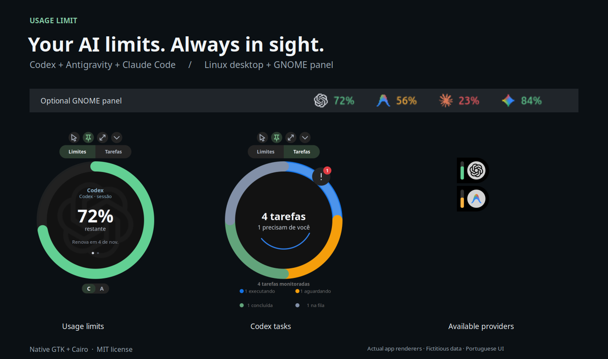

# Usage Limit

**Acompanhe limites de IA e tarefas do Codex enquanto programa.**

Widget flutuante para Linux com suporte a **Codex, Antigravity e Claude Code** e **indicador opcional na barra do GNOME/Ubuntu**. Feito com Python, GTK 3 e Cairo.

[English](../README.md) · [Uso e configuração (inglês)](usage.md) · [Como contribuir](../CONTRIBUTING.md) · [Versões](https://github.com/mehiel-victor/usage-limit/releases)

<picture>
  <source media="(prefers-color-scheme: light)" srcset="../assets/preview-light.png">
  
</picture>

*Prévia renderizada pelo código Cairo do aplicativo com dados fictícios. A interface atual está em português.*

## O que ele faz

- **Limites visíveis:** percentuais restantes e horários de renovação; alterne entre provedores e janelas disponíveis.
- **Tarefas do Codex:** veja tarefas recentes, abra a fila de tarefas ativas e retorne à conversa no Codex Desktop.
- **Cotas na barra superior:** grupos separados para Codex, Gemini, Claude/GPT do Antigravity, Gemini 4 Argon e Claude Code, exibidos somente quando há cota disponível.
- **Modo compacto:** cápsulas menores, dimensionadas para o monitor, com uma linha por provedor disponível; clique para expandir.
- **Controles e alertas:** fixação, passagem de cliques, redimensionamento, troca de monitor, posição salva, notificações de aprovação/saldo baixo e avisos opcionais no lockscreen.

O widget não adiciona telemetria. Ele lê a saída das CLIs e dados locais de tarefas; as CLIs podem acessar os serviços dos respectivos provedores. As cotas Claude/GPT e Argon vêm do Antigravity, sem login separado. A cota do Codex não representa os limites das conversas do ChatGPT. Veja [acesso a dados e limitações](usage.md#data-access-and-limitations).

## Instalação rápida

Requer **Linux, Python 3.10+, GTK 3, PyGObject e Cairo**, além de pelo menos um provedor configurado. O inicializador usa **X11** por padrão; sessões Wayland precisam de **XWayland**. Não há suporte a Wayland nativo, macOS ou Windows.

No Debian/Ubuntu, instale as dependências do sistema:

```bash
sudo apt update
sudo apt install git python3 python3-gi python3-gi-cairo python3-cairo gir1.2-gtk-3.0 librsvg2-common libnotify-bin
```

Clone e execute:

```bash
git clone https://github.com/mehiel-victor/usage-limit.git
cd usage-limit
./launch-usage-limit
```

| Provedor | Configuração |
| --- | --- |
| Codex | Instale o Codex e faça login. O widget consulta os limites pelo app server local. |
| Antigravity | Instale e autentique a CLI do Antigravity com saída estruturada de `/usage`. |
| Claude Code | Configure a [ponte local de status line](usage.md#claude-code), opcional e dependente de uma conta elegível. |

Um provedor indisponível não impede a leitura dos demais. Para abrir tarefas, é necessário o Codex Desktop com o protocolo `codex://` registrado. Abrir o widget novamente restaura e apresenta a instância existente.

O suporte ao Claude Code foi testado com dados fictícios; uma sessão autenticada real ainda não foi validada. Provedores sem cota válida ficam ocultos, inclusive dados ausentes, antigos ou já renovados do Claude. Uma cota real com 0% restante continua visível.

## Painel opcional no GNOME/Ubuntu

Ative o suporte a Ubuntu AppIndicators na sessão de desktop e execute na pasta do clone:

```bash
sudo apt install gir1.2-ayatanaappindicator3-0.1
./launch-usage-limit-panel --check
python3 install_panel.py
./launch-usage-limit-panel
```

O instalador cria um atalho e **inicia o indicador no próximo login**. Mantenha o clone no mesmo lugar. Veja [detalhes do painel e notificações](usage.md#gnomeubuntu-panel) para entender agrupamentos, cores e lockscreen.

## Adicionar ao menu de aplicativos

```bash
./install.sh
```

O script registra o atalho e o ícone do widget flutuante para o usuário atual. O atalho aponta para esta pasta: mantenha o clone no mesmo lugar. O script não instala dependências nem ativa início automático do widget.

Para atualizar, execute `git pull --ff-only` e reinicie o widget. Para remover o atalho e o ícone gerenciados:

```bash
./uninstall.sh
```

Encerre o painel por `Sair do indicador` antes de desinstalar. O desinstalador remove as entradas gerenciadas pelos dois instaladores e preserva arquivos modificados. A remoção não apaga o clone, a configuração dos provedores nem as preferências do widget.

Atualizando da [v0.1.0](https://github.com/mehiel-victor/usage-limit/tree/v0.1.0)? A visão Git não está incluída. A ponte do Claude Code agora normaliza campos de cota e descarta snapshots antigos; o uso direto do Claude Code fica separado do grupo Claude/GPT do Antigravity.

## Primeira contribuição

Relatos de problemas, testes de instalação, documentação, traduções e código são bem-vindos. Comece pelo [guia de contribuição](../CONTRIBUTING.md) e pelas [issues para iniciantes](https://github.com/mehiel-victor/usage-limit/issues?q=is%3Aissue%20is%3Aopen%20label%3A%22good%20first%20issue%22).

Algumas áreas úteis: instruções para outras distribuições, testes dos parsers com dados fictícios e compatibilidade entre desktops. Ao relatar um problema, informe a distribuição Linux e o tipo de sessão.

Testes e verificações de sintaxe:

```bash
python3 -m unittest discover -s . -p 'test_*.py' -v
python3 -m compileall -q ./*.py
sh -n install.sh
sh -n uninstall.sh
bash -n launch-usage-limit
sh -n launch-usage-limit-panel
```

A suíte cobre agrupamento/ícones do painel, ativação do widget e o fluxo da ponte Claude até widget/painel com dados fictícios. Não substitui testes no desktop nem com provedores autenticados. O fluxo completo está em [CONTRIBUTING.md](../CONTRIBUTING.md).

Se a ferramenta for útil, deixe uma estrela para ajudar outras pessoas a encontrá-la. Compartilhar seu ambiente e contribuir com uma correção também ajuda o projeto.

## Licença e créditos

O código usa a [licença MIT](../LICENSE). As marcas dos provedores pertencem aos respectivos titulares; veja os [créditos dos assets](../assets/README.md). Este é um projeto independente da comunidade, sem vínculo oficial com OpenAI, Google ou Anthropic.

O tratamento visual se inspira em [Liquid Glass for GNOME Shell](https://github.com/ryohsuke1231/liquid-glass), sem exigir a extensão ou seus shaders. Consulte o [Código de Conduta](../CODE_OF_CONDUCT.md) e a [política de segurança](../SECURITY.md).
